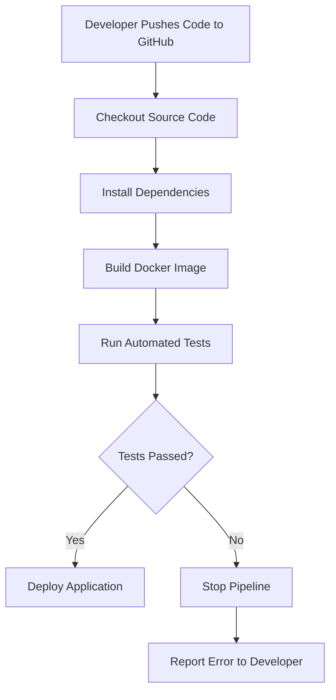

# Activity 5 – CI/CD Pipeline

## What is CI/CD?
CI/CD is a process that automates testing and delivery of software.

- **CI (Continuous Integration):** Automatically checks and tests code after changes.
- **CD (Continuous Delivery/Deployment):** Prepares or deploys the application after successful tests.

## CI/CD Pipeline Flow

## Pipeline Stages

1. **Push Code:** Developer uploads code changes to GitHub.
2. **Checkout:** Pipeline gets the latest source code.
3. **Install Dependencies:** Required packages are installed.
4. **Build Docker Image:** Docker creates an image using the Dockerfile.
5. **Run Tests:** Automated tests check the application.
6. **Deploy:** If all tests pass, the application can be deployed.

## Result
The CI/CD pipeline helps detect errors early, improves software quality, and automates the delivery process.
