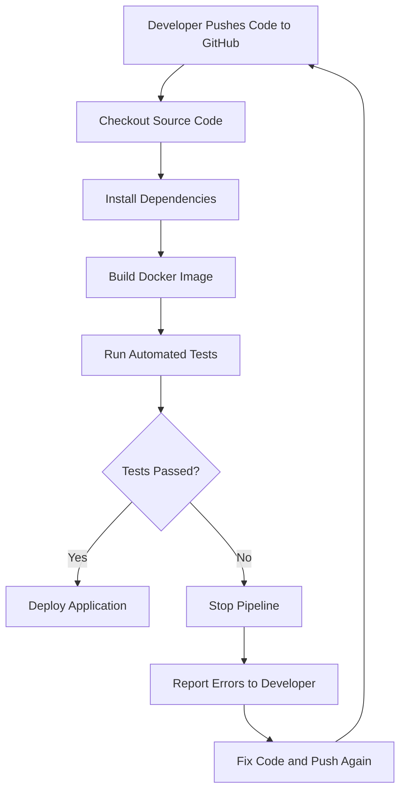

# Activity 5 – CI/CD Pipeline

## 1. What is CI/CD?

CI/CD is a process that automates software integration, testing, and delivery.

- **Continuous Integration (CI):** Automatically checks and tests code changes.
- **Continuous Delivery/Deployment (CD):** Prepares or deploys the application after successful tests.

## 2. CI/CD Pipeline Flow

## 3. Pipeline Stages

1. **Push Code:** Developer uploads changes to GitHub.
2. **Checkout:** Pipeline retrieves the latest source code.
3. **Install Dependencies:** Required packages are installed.
4. **Build Docker Image:** Docker builds an image using the Dockerfile.
5. **Run Tests:** Automated tests check the application.
6. **Decision:** Pipeline checks whether all tests passed.
7. **Deploy:** If tests pass, the application can be deployed.

## 4. Pipeline Result

The pipeline automates testing and helps detect errors before deployment. It improves software quality and reduces manual work.

