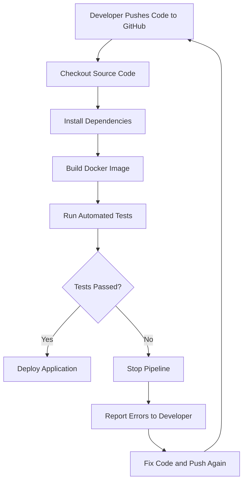

# Activity 5 – CI/CD Pipeline

## 1. What is CI/CD?

CI/CD is a process that automates software integration, testing, and delivery.

- **Continuous Integration (CI):** Automatically checks and tests code changes.
- **Continuous Delivery/Deployment (CD):** Prepares or deploys the application after successful tests.

## 2. CI/CD Pipeline Flow

The following diagram shows the main stages of a CI/CD pipeline.

## 3. Pipeline Stages

1. **Push Code:** The developer uploads code changes to GitHub.
2. **Checkout:** The pipeline retrieves the latest source code.
3. **Install Dependencies:** Required packages are installed.
4. **Build Docker Image:** Docker builds an image using the Dockerfile.
5. **Run Tests:** Automated tests check the application.
6. **Decision:** The pipeline checks whether all tests have passed.
7. **Deploy:** If all tests pass, the application can be deployed.

## 4. Pipeline Result

The pipeline automates testing and helps detect errors before deployment. It improves software quality and reduces manual work.

## 5. Test Failure Stage

The test failure occurs during the **Run Automated Tests** stage.

If one or more tests fail:

1. The test stage reports a failure.
2. The CI/CD pipeline stops.
3. The deployment stage is skipped.
4. Error logs are generated and reported to the developer.
5. The developer fixes the problem and pushes the updated code.
6. The pipeline runs again.

### Example

If the `/api/tasks` endpoint returns an incorrect response, the related test fails. The pipeline stops and the application is not deployed until the problem is fixed.

### Conclusion

The test stage prevents faulty code from reaching production. It ensures that only code that passes the required tests proceeds to deployment.

